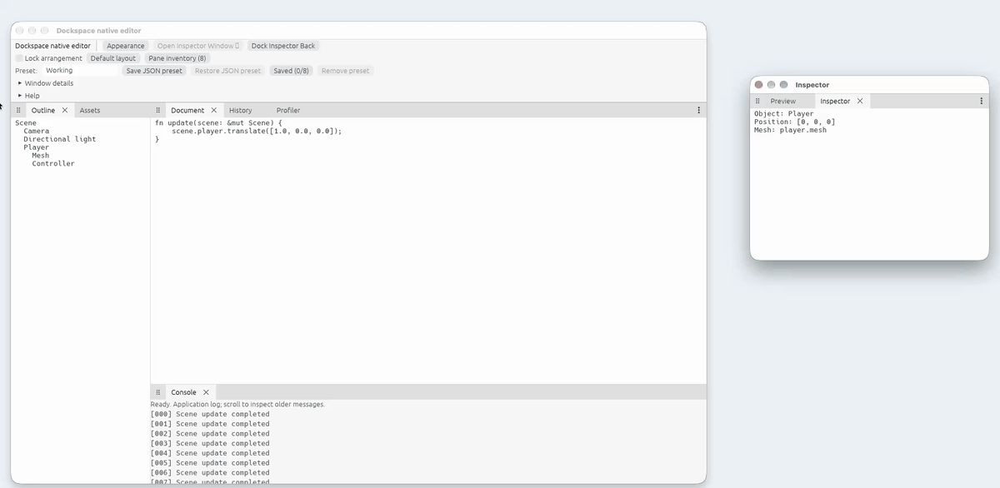

#  Dockspace

**A renderer-neutral docking engine for Rust editor UIs** — with official `egui` adapters and a three-tier integration kit for any immediate-mode or retained-mode UI framework.

[Live Web Demo](https://frankorz.com/dockspace/demo/egui/) ·
[Homepage](https://frankorz.com/dockspace/) ·
[Examples](docs/EXAMPLES.md) ·
[Documentation](docs/README.md) ·
[Changelog](CHANGELOG.md)

`Rust 1.95+ (MSRV)` · `#![forbid(unsafe_code)]` · `WebAssembly ready` · `egui 0.37` · `Pre-release`



*Shown above: the experimental [native multiview editor](docs/EXAMPLES.md#experimental-native-windows) docking tabs across two OS windows with motion enabled. For single-window desktop and WebAssembly apps, [`egui_dockspace`](crates/egui_dockspace) runs directly on official `egui` with no forks.*

---

## Why Dockspace?

- **Truly UI-framework-neutral (`dockspace::host`)** — The core has zero GUI, async runtime, or event-loop dependencies, forbids `unsafe`, and builds for `wasm32`. It ships a three-tier integration kit (`SurfaceDisplayList`, `SurfaceProgramVisitor`, `LogicalHost`, `NativeReportDigest`) already proven across four distinct UI paradigms: **`egui`**, **`Open GPUI`**, **`winit + softbuffer`**, and **`ratatui`**.
- **Composable `Pane` / `Tabs` / `Split` / `Grid` layouts** — Nest an entire layout inside a single named tab, keep bare panes without forced tab bars, and resize shared `Grid` row/column tracks or multi-arm splitter junctions atomically with explicit min/max sizing constraints.
- **Application-owned content & deferred close approval** — Layouts reference panes by stable `ItemId`. Your application keeps all documents and widget state across moves, hides, and restores, and can approve, veto, or hold a deferred close token while saving asynchronously.
- **Deterministic presentation & fail-closed input** — Two-step presentation settlement and explicit occlusion proofs (`PointerClearance`) prevent clicks through modals or stale geometry, paired with interruptible spring/tween `motion` that honors `prefers-reduced-motion`.
- **First-class multiview & persistence protocols** — Core-owned OS-window lifecycles, recovery, and Dock Back semantics alongside optional `serde` layout documents completely decoupled from application pane data.

---

## Try It in 30 Seconds

Try the **[browser workbench](https://frankorz.com/dockspace/demo/egui/)** with zero setup, or run any host locally:

```sh
# Official egui desktop workbench (single OS window, winit + WGPU, no fork)
cargo run -p egui_dockspace --example workbench --features wgpu --locked

# Interactive third-party TUI workbench built exclusively on `dockspace::host` + ratatui
cargo run --manifest-path integration/ratatui-demo/Cargo.toml --locked

# Zero-dependency custom UI host example (both retained display-list and immediate visitor)
cargo run -p dockspace --example custom_ui_host --locked
```

Browse [docs/EXAMPLES.md](docs/EXAMPLES.md) for all runnable examples (shared grids, background save, workspace persistence, software winit multiview, and WebAssembly).

---

## Quickstart

Until `0.1.0` is published on crates.io, depend on a local checkout (path dependencies below):

### Option A — Use with `egui` (`egui_dockspace`)

```toml
[dependencies]
dockspace = { path = "../dockspace/crates/dockspace" }
egui_dockspace = { path = "../dockspace/crates/egui_dockspace", features = ["wgpu"] }
egui = "0.37"
```

Keep pane data in your own struct and implement `PaneView`:

```rust
use egui_dockspace::{ItemId, PaneResponse, PaneView};

struct Documents {
    text: String,
}

impl PaneView for Documents {
    fn title(&self, _item: ItemId) -> Option<egui::WidgetText> {
        Some("Document".into())
    }

    fn ui(&mut self, item: ItemId, ui: &mut egui::Ui) -> PaneResponse {
        let id = egui::Id::unique(("editor", item));
        let editor = ui.add(egui::TextEdit::multiline(&mut self.text).id(id));
        PaneResponse::from(&editor)
    }
}
```

Pass your `Documents` registry to `egui_dockspace::winit::run_native` (for full drag docking) or `Dockspace::show_single_surface` (inside an existing `eframe::App::ui`). See [crates/egui_dockspace/README.md](crates/egui_dockspace/README.md) and [examples/winit.rs](crates/egui_dockspace/examples/winit.rs).

### Option B — Integrate Any Rust UI Framework (`dockspace::host`)

```toml
[dependencies]
dockspace = { path = "../dockspace/crates/dockspace" }
```

Use `LogicalHost` to compile each frame into an owned `'static` `SurfaceDisplayList` (ideal for retained UIs like `iced`, `slint`, `dioxus`, `gpui`, or deferred GPU queues) or stream directly through `SurfaceProgramVisitor` (ideal for immediate-mode engines):

```rust
use dockspace::geometry::LogicalRect;
use dockspace::host::{
    LogicalHost, LogicalPaintOutcome, LogicalPointerEvent, PointerClearance,
    SurfaceDisplayStep, SurfaceMetrics,
};
use dockspace::model::{
    DockspaceLayout, DockspaceNode, DockspaceRootLayout, DockspaceSurfaceLayout,
    ItemId, RootId, SurfaceId,
};
use dockspace::policy::DockPolicy;
use dockspace::runtime::{SurfacePointerButton, SurfacePresentationResult};

let surface = SurfaceId::new(1);
let layout = DockspaceLayout::new([DockspaceSurfaceLayout::new(
    surface,
    DockspaceRootLayout::new(
        RootId::new(1),
        DockspaceNode::tabs([ItemId::new(1), ItemId::new(2)]),
    ),
)])?;
let mut host = LogicalHost::from_layout(layout, DockPolicy::default())?;
let mut metrics = SurfaceMetrics::new(LogicalRect::new(0.0, 0.0, 800.0, 600.0)?);

// 1. Measure and compile an owned `'static` display list (or call `paint_with_visitor`).
if let LogicalPaintOutcome::Ready { payload, presentation, .. } =
    host.paint_display_list(surface, &mut metrics)?
{
    for step in payload.steps() {
        if let SurfaceDisplayStep::Pane(pane) = step {
            // Render your widget for `pane.item` inside `pane.content_geometry`.
        }
    }
    // 2. Report actual renderer presentation so hit authority settles atomically.
    host.finish_presentation(presentation, SurfacePresentationResult::Presented)?;
}

// 3. Forward pointer and wheel events with explicit framework occlusion clearance.
host.submit_pointer(LogicalPointerEvent::pressed(
    surface,
    pos,
    SurfacePointerButton::Primary,
    PointerClearance::Unobstructed,
))?;
```

See [crates/dockspace/README.md](crates/dockspace/README.md), [examples/custom_ui_host.rs](crates/dockspace/examples/custom_ui_host.rs), and the full interactive [Ratatui terminal workbench](integration/ratatui-demo/README.md).

---

## Crates & Ecosystem

| Crate / Example | Role | Status | License |
| --- | --- | --- | --- |
| [`dockspace`](crates/dockspace) | Core engine, `dockspace::host` integration kit, optional `motion` & `serde` | Registry release (`0.1.0`) | Apache-2.0 |
| [`dockspace_winit`](crates/dockspace_winit) | Shared `winit 0.30` mouse, coordinate, repaint & optional `native` helpers | Registry release (`0.1.0`) | MIT OR Apache-2.0 |
| [`egui_dockspace`](crates/egui_dockspace) | Official `egui 0.37` adapter (`winit` / `wgpu` / `web` / `eframe` / `accesskit`) | Registry release (`0.1.0`) | MIT OR Apache-2.0 |
| [`egui_dockspace_native`](crates/egui_dockspace_native) | Experimental multi-OS-window egui adapter (pinned `egui`/`winit` forks) | Git / `[patch.crates-io]` | MIT OR Apache-2.0 |
| [`integration/ratatui-demo`](integration/ratatui-demo/README.md) | Third-party TUI reference adapter on `dockspace::host` + `TestBackend` tests | Reference example | MIT OR Apache-2.0 |
| [`integration/gpui-harness`](integration/gpui-harness/README.md) | Retained-view GPUI workbench & native multiview harness (`Open GPUI`) | Reference harness | MIT OR Apache-2.0 |

---

## Host Capabilities & Platform Limits

| Host path | Drag docking & guides | Focus confirmation | Multi-OS windows | Requires forks? |
| --- | --- | --- | --- | --- |
| `egui_dockspace` (`wgpu` / `web` / complete-output) | Full (single window or browser canvas) | Yes | Contained floats only | No |
| `egui_dockspace` (`eframe::App::ui` callback) | Selection, close, menus & keyboard resize | No | No | No |
| `dockspace::host` / `dockspace_winit` (custom UI) | Full (logical or native via host) | Host-supplied | Optional (`Tier 3` / `native`) | No |
| `egui_dockspace_native` (experimental) | Local + finite Linux X11 / macOS cross-window | Yes | Yes (X11 / macOS; Wayland local-only) | Yes (`Latias94/egui`, `Latias94/winit`) |

Physical drag-out to create a new OS window, Windows cross-window pointer input, and arbitrary mixed-monitor DPI remain under active validation. Read [docs/PLATFORM_SUPPORT.md](docs/PLATFORM_SUPPORT.md) before adopting native multiview, and see [docs/MAINTAINING.md](docs/MAINTAINING.md#experimental-native-adapter-and-fork-distribution-policy) for the fork distribution policy.

---

## Learn More

- **Guides**: [Core host guide](crates/dockspace/docs/guide.md) · [egui integration guide](crates/egui_dockspace/docs/guide.md) · [Adapter testing](docs/ADAPTER_TESTING.md) · [Documentation index](docs/README.md)
- **Feature configuration**: `motion` is enabled by default (`MotionMode::Off` or `default-features = false` disables it); enable `serde` for layout persistence.
- **AI coding skill**: [skills/dockspace-integration/SKILL.md](skills/dockspace-integration/SKILL.md) provides host-selection and contract checklists for AI coding assistants.
- **Contributing**: [CONTRIBUTING.md](CONTRIBUTING.md) · [MAINTAINING.md](docs/MAINTAINING.md) · [CHANGELOG.md](CHANGELOG.md)

## License

`dockspace` is licensed under **Apache-2.0**. `dockspace_winit`, `egui_dockspace`, and `egui_dockspace_native` are dual-licensed under **MIT OR Apache-2.0**. See [THIRD_PARTY.md](THIRD_PARTY.md) for prior art and fixture attribution.
