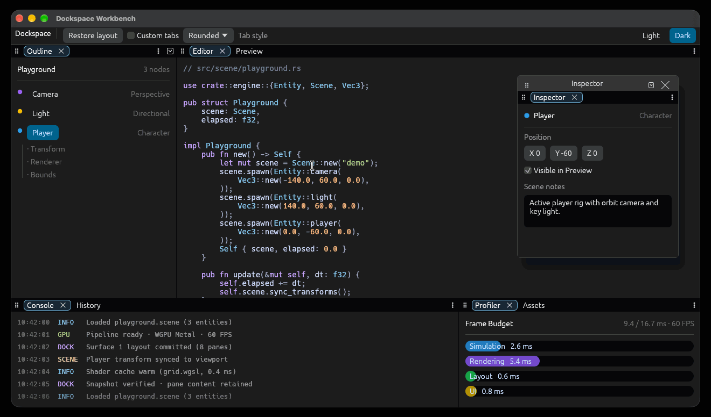

# dockspace

**A renderer-neutral docking engine for Rust editor UIs** — composable layouts, deterministic presentation settlement, optional interruptible motion, and a three-tier `dockspace::host` integration kit for any immediate-mode or retained-mode UI framework.

[Live Web Demo](https://frankorz.com/dockspace/demo/egui/) ·
[Homepage](https://frankorz.com/dockspace/) ·
[Host Guide](https://github.com/Latias94/dockspace/blob/main/crates/dockspace/docs/guide.md) ·
[Examples](https://github.com/Latias94/dockspace/blob/main/docs/EXAMPLES.md) ·
[Changelog](https://github.com/Latias94/dockspace/blob/main/CHANGELOG.md)

`Rust 1.95+ (MSRV)` · `#![forbid(unsafe_code)]` · `Zero GUI or async deps` · `WebAssembly ready` · `Pre-release`



---

## Why `dockspace`?

- **Pure, framework-neutral core** — Zero GUI, windowing, GPU, or async-runtime dependencies, `#![forbid(unsafe_code)]`, and `wasm32`-ready. Already drives four distinct UI paradigms: **`egui`**, **`Open GPUI`**, **`winit + softbuffer`**, and **`ratatui`**.
- **Composable `Pane` / `Tabs` / `Split` / `Grid` + floating roots** — Nest a full layout inside a single named tab, keep bare panes without forced tab bars, and resize shared `Grid` tracks or multi-arm splitter junctions atomically with per-pane `PaneSizing` bounds.
- **Application-owned content & deferred close** — Layouts reference panes by stable `ItemId`; your application owns all documents and widget state across moves, hides, and restores, and resolves close requests immediately or asynchronously with deferred decision tokens.
- **Deterministic frames & fail-closed input** — Atomic two-step presentation settlement (`Presented` / `Dropped`) and explicit occlusion clearance (`PointerClearance`) prevent clicks through modals or stale geometry, paired with optional interruptible `motion`.
- **Optional persistence & native multiview protocols** — Core-owned multi-surface and OS-window lifecycle protocols alongside `serde` JSON layout documents decoupled from pane data.

> Building an `egui` app? Start directly with [`egui_dockspace`](https://github.com/Latias94/dockspace/tree/main/crates/egui_dockspace). Building a custom `winit` host? Pair this crate with [`dockspace_winit`](https://github.com/Latias94/dockspace/tree/main/crates/dockspace_winit).

---

## Quickstart (`dockspace::host`)

Until `0.1.0` is published on crates.io, depend on a local checkout:

```toml
[dependencies]
dockspace = { path = "../dockspace/crates/dockspace" }
```

Use `LogicalHost` to compile each frame into an owned `'static` `SurfaceDisplayList` (ideal for retained UIs like `iced`, `slint`, `dioxus`, `gpui`, or deferred GPU queues) or stream directly through `SurfaceProgramVisitor` (ideal for immediate-mode engines):

```rust
use dockspace::geometry::{LogicalPoint, LogicalRect};
use dockspace::host::{
    LogicalHost, LogicalPaintOutcome, LogicalPointerEvent, PointerClearance,
    SurfaceDisplayStep, SurfaceMetrics,
};
use dockspace::model::{
    DockspaceLayout, DockspaceNode, DockspaceRootLayout, DockspaceSurfaceLayout,
    ItemId, RootId, SurfaceId,
};
use dockspace::policy::DockPolicy;
use dockspace::runtime::{SurfacePointerButton, SurfacePresentationResult};

fn main() -> Result<(), Box<dyn std::error::Error>> {
    let surface = SurfaceId::new(1);
    let layout = DockspaceLayout::new([DockspaceSurfaceLayout::new(
        surface,
        DockspaceRootLayout::new(
            RootId::new(1),
            DockspaceNode::central_tabs([ItemId::new(1), ItemId::new(2)]),
        ),
    )])?;
    let mut host = LogicalHost::from_layout(layout, DockPolicy::default())?;
    let mut metrics = SurfaceMetrics::new(LogicalRect::new(0.0, 0.0, 800.0, 600.0)?);

    // 1. Measure and compile an owned `'static` display list (or call `paint_with_visitor`).
    if let LogicalPaintOutcome::Ready { payload, presentation, .. } =
        host.paint_display_list(surface, &mut metrics)?
    {
        for step in payload.steps() {
            if let SurfaceDisplayStep::Pane(pane) = step {
                // Render your widget for `pane.item` inside `pane.content_geometry`.
                let _ = (pane.item, pane.content_geometry);
            }
        }
        // 2. Report actual renderer presentation so hit authority settles atomically.
        host.finish_presentation(presentation, SurfacePresentationResult::Presented)?;
    }

    // 3. Forward pointer & wheel events with explicit framework occlusion clearance.
    host.submit_pointer(LogicalPointerEvent::pressed(
        surface,
        LogicalPoint::new(120.0, 14.0)?,
        SurfacePointerButton::Primary,
        PointerClearance::Unobstructed,
    ))?;
    Ok(())
}
```

---

## Three-Tier Integration Kit (`dockspace::host`)

Choose the lowest tier that fits your framework:

- **Tier 1 — Surface Rendering (`SurfaceDisplayList`, `SurfaceProgramVisitor`, `SurfaceMetrics`)**: compile a paint plan into an owned `'static` display list for retained UIs and deferred GPU queues, or implement only the chrome methods you draw on `SurfaceProgramVisitor`.
- **Tier 2 — Logical Host (`LogicalHost`, `LogicalPointerEvent`, `PointerClearance`)**: single-window and multi-surface logical hosting with two-step presentation settlement (`LogicalPresentationToken` → `finish_presentation`), independent click/drag/scroll lane resolution, and fail-closed pointer routing.
- **Tier 3 — Native Multiview (`NativeReportDigest`, `NativeWindowRetirementState`, `NativeWindows`)**: shared native-window report synchronization, deduplicated window repaints, and exact quiescence tracking.

For direct access to the complete low-level protocol, use `model`, `policy`, and `runtime::DockspaceSession`:

1. Begin a host frame and submit ordered input and application commands.
2. Supply logical measurements and execute the returned surface program into your renderer or an owned display list.
3. Confirm complete program acceptance, then commit the frame.
4. Report whether the exact output was `Presented` or `Dropped`; accept that report in a later committed frame before routing input against it.

A logical surface is a layout/input area rather than a forced OS window. Multiple surfaces can share one host, and native window effects are explicit host requests rather than hidden calls into an event loop.

---

## Runnable Examples

From the repository root:

```sh
# Layout commands: select, open, move panes and inspect committed outcomes
cargo run -p dockspace --example layout_commands --locked

# Zero-dependency custom UI host (~230 lines, both retained display list and immediate visitor)
cargo run -p dockspace --example custom_ui_host --locked

# Interactive third-party TUI workbench built exclusively on `dockspace::host` + ratatui
cargo run --manifest-path integration/ratatui-demo/Cargo.toml --locked

# Complete low-level recording-renderer host without egui
cargo run --manifest-path integration/dockspace-host-harness/Cargo.toml --example engine_host --locked
```

See the [composition guide](https://github.com/Latias94/dockspace/blob/main/crates/dockspace/docs/guide.md#composable-layouts), the [host guide](https://github.com/Latias94/dockspace/blob/main/crates/dockspace/docs/guide.md), and the [adapter testing guide](https://github.com/Latias94/dockspace/blob/main/docs/ADAPTER_TESTING.md) for full contracts and reusable conformance scenarios.

---

## Core Capabilities & Customization

- **Application-owned registry**: keep pane data in your own struct keyed by `ItemId`.
- **Policy & presentation geometry**: configure move/close rules, compatibility, and arrangement locking with `DockPolicy` (including `set_allow_root_resize_axis` per root independently of floating borders); tune chrome geometry and interaction timing with `DockPresentationConfig` and per-pane `PaneSizing` bounds.
- **Precision**: layout weights, docking fractions, and logical geometry use `f64` throughout core and persistence; convert to your renderer's coordinate type at the adapter boundary.
- **Visibility vs. close**: `frame.set_item_visibility_current(item, false)` hides an open pane while preserving its tab order, split proportions, and window ownership (`is_visible()` / `visible_items()`; showing does not request focus). Closing removes the slot after application approval (immediate or via deferred token).
- **Layout persistence (`serde`)**: save and restore JSON layout documents with stable external pane keys and optional native placement preferences; file storage and pane content stay application-owned.
- **Interruptible motion (`motion`, default)**: supplies `EaseOut` 200 ms reflow by default from a host-provided monotonic clock. Disable at runtime with `MotionMode::Off`, omit `set_motion` for static hosts, or compile without it via `default-features = false` ([motion guide](https://github.com/Latias94/dockspace/blob/main/crates/dockspace/docs/guide.md#motion)).

---

## Companion Crates

| Crate | Role | License |
| --- | --- | --- |
| `dockspace` *(this crate)* | Renderer-neutral core engine and `dockspace::host` integration kit | Apache-2.0 |
| [`dockspace_winit`](https://github.com/Latias94/dockspace/tree/main/crates/dockspace_winit) | Shared `winit 0.30` mouse, coordinate, repaint & optional `native` helpers | MIT OR Apache-2.0 |
| [`egui_dockspace`](https://github.com/Latias94/dockspace/tree/main/crates/egui_dockspace) | Official `egui 0.37` adapter (`winit` / `wgpu` / `web` / `eframe` / `accesskit`) | MIT OR Apache-2.0 |
| [`egui_dockspace_native`](https://github.com/Latias94/dockspace/tree/main/crates/egui_dockspace_native) | Experimental multi-OS-window `egui` adapter *(Git / pinned forks)* | MIT OR Apache-2.0 |

---

## Cargo Features

| Feature | Purpose |
| --- | --- |
| `motion` *(default)* | Interruptible presentation geometry with a host-supplied monotonic clock; no renderer or platform dependency |
| `serde` | JSON layout documents with stable pane keys and optional native placement preferences |

With `default-features = false`, the core retains static docking, composable layouts, close decisions, and native lifecycle protocols with zero motion or serialization dependencies.

[Examples](https://github.com/Latias94/dockspace/blob/main/docs/EXAMPLES.md) ·
[Platform support](https://github.com/Latias94/dockspace/blob/main/docs/PLATFORM_SUPPORT.md) ·
[Repository](https://github.com/Latias94/dockspace)

## License

Apache-2.0. See [THIRD_PARTY.md](https://github.com/Latias94/dockspace/blob/main/THIRD_PARTY.md) for attribution.
