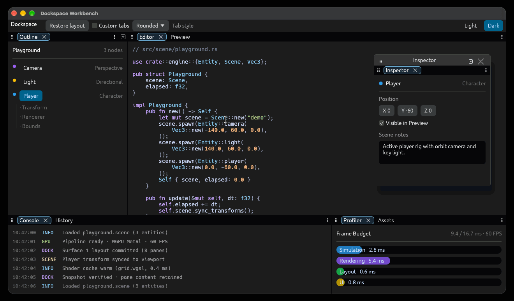

# egui_dockspace

**Deterministic docking layouts for official `egui 0.37`** — backed by the renderer-neutral [`dockspace`](https://github.com/Latias94/dockspace/tree/main/crates/dockspace) core, with zero forks and first-class desktop + WebAssembly support.

[Live Web Demo](https://frankorz.com/dockspace/demo/egui/) ·
[Homepage](https://frankorz.com/dockspace/) ·
[Integration Guide](https://github.com/Latias94/dockspace/blob/main/crates/egui_dockspace/docs/guide.md) ·
[Examples](https://github.com/Latias94/dockspace/blob/main/docs/EXAMPLES.md) ·
[Changelog](https://github.com/Latias94/dockspace/blob/main/CHANGELOG.md)

`Rust 1.95+ (MSRV)` · `#![forbid(unsafe_code)]` · `egui 0.37` · `WebAssembly ready` · `Pre-release`



*Shown above: the zero-fork `egui_dockspace` desktop workbench (`winit` + `wgpu`) — 5-way drop guides, edge splitting with motion reflow, splitter resizing, docking a floating Inspector, live pane state retention, custom tab chrome, Shift+drag floating, and theme switching.*

---

## Why `egui_dockspace`?

- **Official `egui 0.37`, zero forks** — Works directly with crates.io `egui` / `winit` / `wgpu` / `eframe`. Need multiple native OS windows? See the separate experimental [`egui_dockspace_native`](https://github.com/Latias94/dockspace/tree/main/crates/egui_dockspace_native) adapter.
- **Composable `Pane` / `Tabs` / `Split` / `Grid` + contained floats** — Nest complete layouts inside a named tab, keep bare panes without forced tab bars, drag tabs with **Shift** to float inside the window, and resize shared `Grid` tracks or splitters atomically with per-pane `PaneSizing` constraints.
- **Application-owned pane state & deferred close** — The layout stores stable `ItemId` values; your app owns documents, canvases, and widget state via `PaneView`, and can approve, veto, or hold a deferred close token while saving asynchronously.
- **Customizable chrome, motion & AccessKit** — Compact rounded tabs follow the active `egui` theme out of the box, with `TabStylePreset` presets, `PaneView` chrome callbacks, interruptible `motion` (honoring `prefers-reduced-motion`), keyboard navigation, and optional `accesskit` delivery.
- **One `NativeApp` for desktop and browser** — Run the same `NativeApp` on native desktop (`wgpu`) and `wasm32-unknown-unknown` (`web`), or plug `Dockspace` into your own renderer or `eframe::App::ui` callback.

---

## Try It Locally

Try the **[browser workbench](https://frankorz.com/dockspace/demo/egui/)** with zero setup, or run the desktop examples from the repository root:

```sh
# Full-featured workbench (tabs, splits, floating groups, sizing, custom chrome, motion)
cargo run -p egui_dockspace --example workbench --features wgpu --locked

# Minimal 96-line runnable editor with full drag docking
cargo run -p egui_dockspace --example winit --features wgpu --locked
```

In the workbench: drag tabs onto panes to merge or split, resize dividers, hold **Shift** while dragging a tab to float it, use the six-dot grip to move/dock an entire tab group or floating window, toggle **Custom tabs** / **Tab style** / **Light & Dark**, enable **Sizing → Pane sizing demo** (and double-click the Outline divider to restore its preferred width), or adjust curves and reduced motion in the motion bar.

---

## Choosing a Host Path

| Integration | Capabilities | Entry point |
| --- | --- | --- |
| Built-in `wgpu` runner (desktop) | Full drag docking, guides, contained floats & focus confirmation in one OS window | `egui_dockspace::winit::run_native` ([`examples/winit.rs`](https://github.com/Latias94/dockspace/blob/main/crates/egui_dockspace/examples/winit.rs)) |
| Browser canvas (`web`) | Full drag docking and contained floats inside an HTML canvas | `egui_dockspace::winit::run_web` ([`integration/egui-web-demo`](https://github.com/Latias94/dockspace/tree/main/integration/egui-web-demo)) |
| Custom complete-output host | Full drag docking with your own `winit` event loop or GPU renderer | `Dockspace::run_single_surface_with_ui` ([host guide](https://github.com/Latias94/dockspace/blob/main/crates/egui_dockspace/docs/guide.md#complete-output-hosts)) |
| Ordinary `eframe::App::ui` callback | Rendering, tab selection, close approval, menus & keyboard resize *(no drag docking or focus confirmation)* | `Dockspace::show_single_surface` ([`examples/basic.rs`](https://github.com/Latias94/dockspace/blob/main/crates/egui_dockspace/examples/basic.rs)) |
| Multi-OS-window native host (experimental) | Child OS windows, cross-window drag & OS recovery *(requires pinned `egui`/`winit` forks)* | [`egui_dockspace_native`](https://github.com/Latias94/dockspace/tree/main/crates/egui_dockspace_native) · [platform matrix](https://github.com/Latias94/dockspace/blob/main/docs/PLATFORM_SUPPORT.md) |

Complete-output hosts settle hit authority only after the renderer presents that exact `FullOutput`; a plain `eframe::App::ui` callback cannot observe renderer presentation.

---

## Quickstart (`wgpu` Runner)

Until `0.1.0` is published on crates.io, depend on a local checkout:

```toml
[dependencies]
dockspace = { path = "../dockspace/crates/dockspace" }
egui_dockspace = { path = "../dockspace/crates/egui_dockspace", features = ["wgpu"] }
egui = "0.37"
```

Keep pane data in your own struct, implement `PaneView`, and drive a single window with `winit::run_native`:

```rust
use dockspace::policy::{CloseCapability, DockPolicy};
use egui_dockspace::{
    Dockspace, DockspaceLayout, DockspaceNode, DockspaceOutput, DockspaceRootLayout,
    DockspaceSurfaceLayout, ItemId, PaneResponse, PaneView, RootId, SurfaceId,
    winit::{AppResult, NativeApp, NativeOptions, run_native},
};

const SURFACE: SurfaceId = SurfaceId::new(1);

struct Editor {
    dockspace: Dockspace,
    documents: Documents,
}

impl NativeApp for Editor {
    fn update(
        &mut self,
        context: &egui::Context,
        input: egui::RawInput,
    ) -> AppResult<DockspaceOutput> {
        let (output, _) =
            self.dockspace
                .run_single_surface(context, input, SURFACE, &mut self.documents)?;
        Ok(output)
    }
}

struct Documents([String; 2]);

impl PaneView for Documents {
    fn title(&self, item: ItemId) -> Option<egui::WidgetText> {
        match item.get() {
            1 => Some("Document".into()),
            2 => Some("Notes".into()),
            _ => None,
        }
    }

    fn ui(&mut self, item: ItemId, ui: &mut egui::Ui) -> PaneResponse {
        let index = usize::from(item.get() == 2);
        let id = document_focus(item);
        let editor = egui::TextEdit::multiline(&mut self.0[index])
            .id(id)
            .frame(egui::Frame::NONE);
        let bounds = ui.available_rect_before_wrap();
        let response = egui_dockspace::with_pane_keyboard_input_at(
            ui,
            id,
            editor.get_event_filter(),
            bounds,
            |ui| ui.put(bounds, editor),
        );
        PaneResponse::from(&response)
    }

    fn focus_target(&self, item: ItemId) -> Option<egui::Id> {
        Some(document_focus(item))
    }

    fn accepts_deferred_keyboard_input(&self, _: ItemId) -> bool {
        true
    }
}

fn document_focus(item: ItemId) -> egui::Id {
    egui::Id::unique(("editor-document", item))
}

fn main() -> Result<(), Box<dyn std::error::Error>> {
    let layout = DockspaceLayout::new([DockspaceSurfaceLayout::new(
        SURFACE,
        DockspaceRootLayout::new(
            RootId::new(1),
            DockspaceNode::central_tabs([ItemId::new(1), ItemId::new(2)]),
        ),
    )])?;
    let mut policy = DockPolicy::default();
    policy.set_close_capability(CloseCapability::Disabled);
    let mut editor = Editor {
        dockspace: Dockspace::builder("editor", layout).policy(policy).build()?,
        documents: Documents([
            "Edit this document. Drag its tab to split or move it.".into(),
            "Hold Shift while dragging to float this tab inside the window.".into(),
        ]),
    };
    run_native(NativeOptions::default(), egui::Context::default(), &mut editor)?;
    Ok(())
}
```

Use `NativeApp::frame_finished` for application commands after rendering, or enable the `winit` feature (without `wgpu`) to connect `WinitIntegration` to your own event loop and renderer. For non-`egui` frameworks on `winit`, see [`dockspace_winit`](https://github.com/Latias94/dockspace/tree/main/crates/dockspace_winit).

---

## Pane Contract, Sizing & Async I/O

- **Input ownership (`PaneResponse`)** — Return widget responses created inside `PaneView::ui` via `PaneResponse::from`, `with_content`, `with_content_ids`, or `with_scroll_area` (registering inner scrollable controls separately) so ordinary widgets retain pointer ownership during docking.
- **Focus & missing panes** — Provide a stable `focus_target` (or override `focus_state` for multi-widget panes) so tab activation focuses your editor. Returning `None` from `title` preserves an unavailable pane's layout slot. `Box<dyn PaneView>` is supported.
- **Per-pane sizing (`PaneSizing`)** — Override `PaneView::sizing(&self, item: ItemId) -> PaneSizing` to declare minimum, preferred, maximum, or fixed dimensions. When the layout cannot fit inside the viewport, configure clipping vs. proportional compression via `DockStyle::pane_overflow_policy`.
- **Synchronous callbacks & background tasks** — `PaneView::ui` is synchronous and may run across multiple `egui` passes. Perform I/O on application-owned background threads, merge results back on the UI thread, and request a repaint (see [`examples/background_save.rs`](https://github.com/Latias94/dockspace/blob/main/crates/egui_dockspace/examples/background_save.rs)).

---

## Styling, Motion & Persistence

### Styling & input

`DockStyle` derives from the active `egui` theme with compact `Rounded` tabs by default. Use `DockStyle::from_egui(ui)` or `DockStyle::from_egui_with_density(ui, DockDensity::Comfortable)` to scale metrics from your fonts, pick a preset from `TabStylePreset::{Dockspace, Rounded, EguiTiles}`, or tweak fields directly:

```rust
use egui_dockspace::DockStyle;

let mut style = DockStyle::default();
style.tab_bar_height = 26.0;
style.tab_horizontal_padding = 12.0;
style.tab_background_inset = egui::vec2(3.0, 2.0);
```

Override `PaneView` chrome callbacks to customize tabs, tab-bar controls, splitters, menus, drop guides, and drop previews while preserving docking hit-testing and accessibility ([styling guide](https://github.com/Latias94/dockspace/blob/main/crates/egui_dockspace/docs/guide.md#styling)). Configure gestures and shortcuts with `DockInputConfig` and move/close/resize permissions with `DockPolicy` ([input guide](https://github.com/Latias94/dockspace/blob/main/crates/egui_dockspace/docs/guide.md#pointer-input)).

### Motion

Interruptible geometry motion (`EaseOut` 200 ms reflow by default; direct pointer tracking for dividers and drag proxies) is enabled by default and respects reduced motion. Disable it at runtime or omit it at compile time with `default-features = false`:

```rust
use egui_dockspace::{
    Dockspace,
    motion::{MotionMode, MotionSettings},
};

fn disable_motion(dockspace: &mut Dockspace) {
    dockspace.set_motion_settings(MotionSettings {
        mode: MotionMode::Off,
        ..Default::default()
    });
}
```

Each effect supports `Transition::Instant`, `Tween` (with built-in or custom `CubicBezier` curves), or `CriticalSpring` ([motion guide](https://github.com/Latias94/dockspace/blob/main/crates/egui_dockspace/docs/guide.md#motion)).

### Layout persistence (`serde`)

Enable the `serde` feature to save and restore layouts via `save_document_json` and `from_document_json`, reconnecting application pane state through `item_id_for_external_key` while keeping storage and pane data in your application ([persistence guide](https://github.com/Latias94/dockspace/blob/main/crates/egui_dockspace/docs/guide.md#persistence)).

---

## Examples

Run any example from the repository root (`workbench`, `winit`, and `shared_grid` use the complete-output `wgpu` runner for full drag docking; the remaining examples focus on application workflows via `eframe`):

| Example | What it demonstrates | Run command |
| --- | --- | --- |
| [Workbench](https://github.com/Latias94/dockspace/blob/main/crates/egui_dockspace/examples/workbench.rs) | Complete editor with custom tabs, sizing demo, motion & themes | `cargo run -p egui_dockspace --example workbench --features wgpu --locked` |
| [Minimal winit editor](https://github.com/Latias94/dockspace/blob/main/crates/egui_dockspace/examples/winit.rs) | 96-line complete-output single-window editor | `cargo run -p egui_dockspace --example winit --features wgpu --locked` |
| [Shared grid](https://github.com/Latias94/dockspace/blob/main/crates/egui_dockspace/examples/shared_grid.rs) | Shared `Grid` row/column tracks & nested layout tabs | `cargo run -p egui_dockspace --example shared_grid --features wgpu --locked` |
| [Basic panes](https://github.com/Latias94/dockspace/blob/main/crates/egui_dockspace/examples/basic.rs) | Ordinary `eframe::App::ui` callback integration | `cargo run -p egui_dockspace --example basic --features example-app --locked` |
| [Composable layouts](https://github.com/Latias94/dockspace/blob/main/crates/egui_dockspace/examples/composable.rs) | Named nested layouts and bare panes | `cargo run -p egui_dockspace --example composable --features example-app --locked` |
| [Background save](https://github.com/Latias94/dockspace/blob/main/crates/egui_dockspace/examples/background_save.rs) | Deferred close tokens & async save veto/approval | `cargo run -p egui_dockspace --example background_save --features example-app --locked` |
| [Workspace persistence](https://github.com/Latias94/dockspace/blob/main/crates/egui_dockspace/examples/workspace_persistence.rs) | JSON layout presets, autosave & missing-pane recovery | `cargo run -p egui_dockspace --example workspace_persistence --features example-app,serde --locked` |

For browser deployment, follow [integration/egui-web-demo](https://github.com/Latias94/dockspace/tree/main/integration/egui-web-demo) and the [browser startup guide](https://github.com/Latias94/dockspace/blob/main/crates/egui_dockspace/docs/guide.md#browser-startup-and-preferences).

---

## Cargo Features

| Feature | Purpose |
| --- | --- |
| `motion` *(default)* | Interruptible geometry with per-effect timing, curves, and runtime disable / reduced-motion controls |
| `serde` | JSON layout document save/restore; pane data and file storage remain application-owned |
| `winit` | Input and platform-output bridge (`WinitIntegration`) for an existing `winit` event loop and renderer |
| `wgpu` | Complete-output single-window desktop runner (`winit::run_native`) using official `wgpu`; implies `winit` |
| `web` | Complete-output browser runner (`winit::run_web`) on `wasm32-unknown-unknown`; implies `wgpu` |
| `accesskit` | System accessibility tree delivery and action input for the `winit` integration |
| `example-app` | Enables `eframe` for the packaged callback examples |
| `x11` *(default)* | X11 backend when a window integration (`winit` / `wgpu` / `example-app`) is enabled |
| `wayland` *(default)* | Wayland backend when a window integration is enabled |
| `wayland-csd-adwaita` *(default)* | Adwaita client-side decorations for the `winit` runner; implies `wayland` |
| `native-render-support` | Internal sessionless seam for the unpublished `egui_dockspace_native` adapter |

Default Linux backend features activate only when a window integration is enabled and add no event loop or renderer on their own.

## License

Dual-licensed under **MIT OR Apache-2.0**. See [THIRD_PARTY.md](https://github.com/Latias94/dockspace/blob/main/THIRD_PARTY.md) for attribution.
