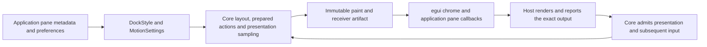

# egui docking chrome design

Status: implemented (2026-11-17). The [integration guide](guide.md#styling)
describes the public styling APIs; the implementation table below identifies
the core and adapter seams that preserve this design.

This is the maintained design baseline for tabs, group controls, contained
floating frames, splitters and docking feedback. Application buttons, editors,
trees, menus and toolbars continue to use egui's own styling.

## Ownership and component structure

The design character is compact, quiet at rest and explicit during interaction.
Defaults combine the Rounded tab recipe with Compact density.
`DockStyle::default()` uses the reference metrics below (`F = 16`);
`from_egui` derives Compact metrics from the actual fonts. Comfortable density
and the other tab recipes remain available.

Keep the existing authority boundary:

Core owns layout, eligibility, action scope, geometry, clips and receiver order.
egui owns painting, ordinary widgets, popup interaction and accessibility
translation. The application owns content, close decisions and host preferences.
The native backend owns physical window observations and execution. Follow
[atomic presentation](../../../docs/adr/0002-atomic-frames-and-presentation.md),
[native composition](../../../docs/adr/0003-native-window-composition.md) and
[motion](../../../docs/adr/0005-motion-and-presentation-geometry.md).

| Object | Identity and scope | Default controls |
| --- | --- | --- |
| Tab / item | One live `ItemId` and its application content | Select, drag one item, request item close |
| Tab group | One exact tabs leaf, captured as `PreparedTabsGroup` | Six-dot group grip; group actions |
| Root layout | One `RootId`, including every split and tabs leaf in its tree | Layout actions |
| Contained floating frame | The same root presented inside a surface | Whole-layout title drag, layout actions, close layout |
| Native window | A separate physical resource and lifetime; an external Root window can compose several surfaces | Host/window-manager controls; native close covers its complete physical roster |

A group capture binds membership, order, selection, session and workspace
version. A long-lived node number or the current location of its former anchor
cannot substitute for that capture. An item's title is display metadata, not
identity. Style and theme changes must preserve content identity.

The default tab bar has one row: group grip, scrollable tabs, optional tab-list
controls, group actions, and the root action anchor when designated by core.
There is no additional 32-point group header around that row. A contained frame
retains its own title bar above its groups, even when it currently has one tab;
the two rows operate on different objects. Explicit tab-bar hiding policies
remain supported, including the existing single-tab reveal control.

## Menus and interaction entrances

Keep three distinct popup controls. Their tooltips and accessibility names state
their scope; icon shape alone is insufficient.

| Control | Appearance | Scope and placement |
| --- | --- | --- |
| List tabs | Small list glyph with a downward cue | Select a member of this group; shown by the strip's overflow policy |
| Tab group actions | Vertical three dots | Current captured group; trailing edge of each visible group bar |
| Layout actions | Window-outline glyph with a downward cue | Entire root; one core-designated anchor in a docked root, or immediately left of Close in a contained title |

The three controls share small glyph painters and keep distinct icons. The root
anchor may share a tab bar with Group actions, but remains a separate control
with a popup heading of **Entire layout**. Group popups use **Tab group**.

Initial Group actions are **Float Tab Group**, **Move Tab Group to New Window**
when the native capability exists, and **Close Tab Group**. Do not add business
commands or a second default tab context menu. Root actions retain **Float
Layout**, **Move Layout to New Window**, **Dock Back**, supported directional
docking and **Close Layout**. Dock Back keeps content open; Close requests
approval. Native creation never bypasses the reservation and first-live protocol.

Absent capabilities omit the corresponding command. A supported but currently
unavailable command is disabled with a reason from core. A no-op is not presented
as a successful move. Popup activation, including keyboard and accessibility
activation, consumes a prepared command for its original scope. If the workspace
changes, invalidate or close that popup; never silently recapture a different
group on click. `SurfacePaintPlan::workspace_stamp` includes the session identity,
so rebuilding a session with the same numeric version also dismisses old menus.
A race at submission still returns the ordinary stale/rejected status, which
the adapter must consume.

Group close uses the existing close-plan pipeline through `prepare_close_tabs`
or `request_close_tabs_current`, with an exact captured-group target. One veto
preserves the whole group; deferred decisions retain the existing tokens.
Unrelated groups and tab reordering do not invalidate approval, while changes
to the target membership, owner, close policy or workspace lifetime do.
The adapter submits one atomic request rather than iterating item-close commands.

| Entrance | Required behavior |
| --- | --- |
| Tab body | Click selects; drag moves one item; never implicitly moves its siblings |
| Tab Close / middle click | Request that item's close without selecting an inactive tab; configured middle-click behavior remains optional |
| Group grip | Drag the captured group, preserving order and selection |
| Unoccupied tab-bar tail | Retain the existing group-drag entrance, only in core-issued empty regions; custom slots and buttons never become handles |
| Contained title background / grip | Move or dock the complete floating root, including its splits |
| List, group or layout menu; shell Close | Operate the named control without starting a drag underneath it |
| Splitter / junction | Directly adjust permitted axes; double click restores preferred extents, or equalizes when no preference exists, subject to configuration |
| Escape / configured docking modifier | Cancel or pause target acquisition through `DockInputConfig`; no separate adapter gesture machine |

Both grips use the existing shared two-column, three-row dot painter. Their
tooltips distinguish **Drag tab group** from **Drag entire floating layout**.
Moving a floating layout over blank canvas leaves it floating. An empty main
area requires its explicit core docking target. Popups and foreign overlays
remain blockers. Loss of capture, surface retirement and cancellation clear
feedback through the existing core lifecycle, including when release is missing.

## Density, geometry and narrow layouts

All measurements are logical egui points. Let `F` be the current Button font's
row height and `I` egui's interaction height. Derive these metrics when the
application selects density or changes fonts; do not silently change measured
chrome during painting. `from_egui_with_density` applies the formulas below.

Compose appearance first, density metrics second, and application overrides last.
Assigning `tab_preset` retains font-derived metrics, whereas
`apply_tab_preset` reapplies its fixed recipe. Keep that distinction explicit in
examples and do not reapply either recipe on every paint pass.
Publish live geometry changes with `set_style` between settled runs. A native
host must build its session from the same `DockStyle::presentation_config`;
changing only painted dimensions would leave native hit geometry stale.

| Metric | Compact, the default | Comfortable |
| --- | --- | --- |
| Tab-bar height `H` | `max(24, F + 8)` | `max(28, F + 12, I)` |
| Contained title height | `H + 4` | `H + 4` |
| Horizontal tab padding `P` | 8 | 10 |
| Close target side `C` | `min(H - 4, max(18, F + 2))` | `min(H - 4, max(22, F + 4))` |
| Grip / menu target side | `H - 2` | `H - 2` |
| Minimum tab width | `max(56, C + 2*P + F)` | `max(64, C + 2*P + F)` |
| Close glyph | 8 | 10 |
| Tab background inset per side | 2 horizontally and vertically | Same |
| Tab corner radius | 6, clamped to the visible background | Same |
| Splitter visible / pointer hit thickness | 1 / 10 | Same |

For `F = 16` and `I <= 28`, these give 24/28-point bars, 28/32-point
contained titles and 18/22-point close targets. At Compact density the
24-point row contains a 20-point-high tab background. Insets already create
four points between adjacent tab backgrounds; do not add a second gap.
Density never reduces the font size. Floating frames and popups inherit egui's
window/popup radius and shadow; docked groups have no shadow or extra rounded
panel wrapper.

The default close icon is visible for selected or hovered tabs and for keyboard
focus, using the existing `TabCloseVisibility` policy. Its allocation remains
stable when hidden. The glyph, response and focus outline stay inside the
core-allocated target and clip. A 26-point target is not painted over a
24-point row. Larger pointer or touch targets require core-approved geometry;
the adapter must not enlarge hit rectangles into adjacent tabs or pane controls.

Core's narrow-strip allocation must first reserve List tabs when needed for
selection, then a usable tab-strip allocation. Remaining control priority is
Layout actions at its designated anchor, Group actions, the grip, and redundant
scroll arrows. Shrink application slots under their existing contract before
removing those built-in selection/action entrances. When the strip's minimum
cannot fit beside List tabs, retain the list and clip the remaining tab space.
Titles elide with a full-title tooltip. Never overlap Close, menu or neighboring
targets to keep a title readable. At widths too small for the control minimum,
clip or omit the control and expose no action for its invisible portion. Fixed
slots and `AfterTabs` content paint only within their actual allocations; no
claim of a full-width border is valid after clipping. Live and future-layout
tab strips use the same core allocation function.

Pane content uses its real allocated viewport and egui clipping, wrapping,
scrolling or canvas navigation. Sizing follows the selected pane's metadata and
the configured overflow policy, as specified by
[pane sizing](../../../docs/adr/0007-pane-sizing-and-explicit-preferences.md).
A capped pane can leave root background uncovered; that background must not be
painted as pane content or given a misleading resize cursor. Pixel alignment may
adjust a stroke's rasterization, never independently round shared layout edges
or create a second receiver geometry. Theme changes preserve geometry; DPI and
coordinate changes follow the existing presentation invalidation protocol.

## Visual states and docking feedback

Colors resolve from the painting Ui's `egui::Visuals`, then explicit
`DockVisualOverrides`, then the existing per-tab callback contract. Keep rich
title colors under that contract. Do not install the design kit's hex palette
as a second global theme. Both light and dark themes use the same dimensions,
icons and action semantics.

| State | Default cue | Evidence |
| --- | --- | --- |
| Selected tab | Quiet accent-tinted background and a fine border; no default overline | Published group selection; several groups can each have a selected tab |
| Hover / press | Local egui interaction feedback; Close has its own small background | The actual enabled control response |
| Pane content focus | Existing two-point underline on its selected tab; no additional group outline or header accent | Observed pane focus for the presented surface, not a pending request or frontmost window |
| Keyboard focus | Immediate outline around the actual tab or control | Framework focus; does not imply content focus |
| Frontmost contained frame | Modest title/background distinction | Core's contained order; does not imply text-input focus |
| Dock target | Directional guide plus translucent result overlay | Core-resolved eligibility and candidate geometry |
| Disabled / pending | Visible but non-operative control, with its applicable reason | Prepared capability or committed lifecycle feedback |

Avoid stacking a selected overline, content underline, group outline and header
accent by default. Applications can replace paint through existing callbacks;
that does not authorize inferred focus. Default enabled text must meet a 4.5:1
contrast target against its actual background in both egui themes. Icons and
outlines needed to identify a control or state target 3:1. Decorative separators
may be quieter; dim inactive text is still enabled text. Check composited hover,
selection and preview backgrounds rather than only the unblended color tokens.
Custom themes remain the application's responsibility to review.

Guide sets come from core. Omit meaningless/no-op destinations, including
self-docking when it cannot change the result; meaningful rejected directions
may remain visibly disabled when core supplies them. Never draw five active
buttons unconditionally or position them from the moving drag proxy. Pane and
root-edge guides preserve their different scopes. A guide's directional cue
must agree with its resulting preview: Left must not fill the whole target
unless that is the actual candidate result.

`DropPreview::target_rect` identifies the current destination;
`rect` is the final candidate payload area, including source removal and
constraint solving; `presentation_rect` is its passive animated decoration.
Use those supplied values rather than assuming a half-pane split. The default
preview paints the result and future tab order, including the payload's actual
insertion position. Future tabs have no receivers. Target text is opt-in through
the existing painter helpers. Rejected, cancelled or revoked targets never keep
an affirmative result overlay. Pending native work is not a completed dock.

## Motion and platform adaptation

Use the shared core motion engine and the existing defaults: structural changes
use 200 ms EaseInOut; preview decoration uses 125 ms EaseOut. Do not add a second
150 ms tab-reorder timeline. Direct drag, split/junction resize and contained
resize follow the constrained pointer immediately, including release. Keyboard
focus is immediate; spatial focus travel remains off by default.

Motion is presentation alongside interaction, not a blocking
`Committed -> Animating -> Idle` state machine. New valid operations can
interrupt it. Invalid intermediate split partitions keep their affected
structural controls unavailable until the corresponding valid Presented artifact
is admitted; animation settlement alone grants no input authority. Tween
retargeting preserves position; critical springs additionally retain
unconstrained velocity. Neither label promises continuity across a required
constraint projection or native lifetime boundary.

`MotionSettings` remains the customization surface: global Off/System,
per-effect Instant/tween/critical spring, duration/response and validated Bezier
curves. It is separate from geometry measurement. Off, zero timing or observed
reduced motion removes spatial travel and animation wakeups while preserving
static focus and drop feedback. An unknown OS preference stays Unknown; the host
may select the existing conservative fallback. egui's zero `animation_time`
also disables geometry motion. Idle chrome schedules no continuous animation.

Other frameworks reuse the core's sampled rectangles, clips, pane order,
prepared actions and repaint report. They translate their own theme and focus
facts, rather than reproducing egui tokens or running another geometry tween.
Hosts retain the actual widgets' stable content identities across supported
moves. Cross-Context state and native focus observations remain host duties.

Contained frames use the custom title described here. Native windows use the
backend's physical decorations and move/resize protocol; the design does not
require a duplicate contained title inside an OS title bar. Native Close follows
the physical roster; logical Close Layout must not close other roots sharing
that window. Unsupported global coordinates or native creation capabilities
disable their corresponding entrances, with contained floating still available.
Cross-window transfers retain the reservation, original content ownership and
exact first-live confirmation;
there is no promised full-pane flight between OS windows or atomic display on
two windows. A fatal native generation follows the existing
[failure lifecycle](../../dockspace/docs/guide.md#permanently-rejected-native-ingress),
not an automatic clear-and-retry hidden behind a visual reset.

## Implementation boundary and alternatives

| Design | Benefits | Cost / decision |
| --- | --- | --- |
| Extend the current style, paint callbacks and prepared actions | One geometry authority; applications retain familiar APIs and optional customization | Implemented through scoped group controls and the existing action pipeline |
| Import fixed design-kit tokens and a new chrome command dispatcher | Literal reproduction of the supplied illustrations | Rejected; duplicates `DockStyle`, font metrics and action/lifecycle ownership |
| Let every application supply all chrome | Maximum visual freedom | Retain as customization where supported; unsuitable as the default because each host would need to rediscover scope and input rules |

| Area | Public seam | Implementation |
| --- | --- | --- |
| Appearance and density | `DockStyle`, `DockDensity`, `TabStylePreset::Rounded`, `DockVisualOverrides` | Rounded/Compact defaults and font-derived metrics; later application field edits remain authoritative |
| Shared icons | Existing drag grips and menu controls | One shared grip painter; distinct list, group and root glyphs in `render/chrome_icons.rs` |
| Root commands | Core-issued presentation menu anchors and commands | Existing scope and native eligibility retained |
| Group commands | `SurfacePaintPlan::tabs_group_command`, `prepare_tabs_close`; session `prepare_close_tabs` | Exact group anchors and prepared commands; `ClosePlanTarget::Tabs` uses the atomic close-plan pipeline |
| Content and control styling | `PaneView::tab_ui`, `tab_close_ui`, `tab_bar_layout`, `tab_bar_ui` | Core-shared measurement, fixed slots and clips; no callback-owned hit expansion |
| Drop customization | `drop_guide_ui`, `drop_preview_ui`, `drag_preview_ui` | Canonical versus animated geometry and paint-only restrictions retained |
| Motion and focus | `MotionSettings`, `Tab::pane_focused`, focus callbacks | Existing defaults and observation rules; no additional animator or inferred group-focus flag |

No new token registry, general `ChromeAction` bus, async trait or adapter layout
state machine is needed. New group controls belong beside existing tab-strip
and presentation actions. Keep glyph painting shared and small; do not introduce
a component framework for a handful of painters.

The implementation has three corresponding boundaries:

1. Core owns exact group-action scope, command availability, close targets and
   tab-bar reservations alongside the existing root menu.
2. egui owns shared icons, Rounded/Compact defaults and font density recipes;
   the workbench demonstrates them with the same public APIs as consumers.
3. Regression coverage checks scope, stale menus, close decisions, narrow bars,
   theme contrast, font/DPI scaling and retained motion contracts. Native tests
   retain their existing reservation, first-live and physical cleanup checks;
   platform input and window-manager qualification remain backend responsibilities.

The main risks are stale popup targets, cramped headers and custom painters
drifting from input geometry. Mitigate them with captured capabilities,
core-owned allocation and a shared immutable artifact. Changing the default
recipe/density is an intentional pre-release visual change; retained explicit
styles and callback customizations still need regression coverage.

## Acceptance

Use the existing core behavior, adapter and native qualification infrastructure.
Deterministic semantic assertions guard scope and ownership; screenshots or
manual review assess appearance. A visual snapshot alone cannot prove docking.

| Scenario | Required result |
| --- | --- |
| Two split groups in one root; float one group through its menu | Only the captured members move, in their order and with their selection; the sibling group's content stays in place |
| Float the same root through Layout actions | Every split group moves; the popup identifies the entire layout |
| Open a group popup, then change its membership | Old commands become stale/disabled or the popup closes; no replacement group is targeted |
| Defer or veto one member of Close Tab Group | No member is partially removed; stale completion cannot close a replacement |
| Drag tab, group grip, empty bar tail and floating title in turn | Each entrance moves exactly its declared payload; Close, menus, custom widgets and blockers never initiate an underlying drag |
| Empty main area, single-tab source, edge and center targets | No-op guides are absent; blank canvas alone does not redock a floating layout; preview and committed payload bounds agree with the same candidate |
| Many columns and an overflowed target strip | Future tab order and insertion are correct after removing the source; all clipped future tabs remain non-interactive |
| Widths 0, 16, 40, 80 and 160 points; long titles and custom slots | Finite, clipped geometry; no overlapping active targets or painted controls outside allocation; List tabs retains priority whenever its minimum fits |
| Compact/Comfortable; font scale 1 and 1.5; DPI 1, 1.25, 1.5 and 2 | Same scopes and receiver order; no clipped close glyph in a fully allocated target, shared-edge gaps or mismatched hit transforms |
| Light/dark; selected but unfocused group; keyboard and content focus | Distinct cues, measured default contrast targets and no focus inferred from hover or z-order |
| Off, reduced motion, tween and spring; rapid retarget and lost capture | Immediate direct manipulation; interruptible transitions; no stale overlay or wakeups after settlement/cancellation |
| Custom tabs, close, guides and previews with every tab recipe | Authoritative bounds, clips, close policy and accessible names/actions are preserved |
| Delayed/dropped output; native move/close/DPI change and foreign blocker | Only admitted presentation authorizes input; exact native roster and first-live/failure contracts remain intact |

Run small deterministic cases for changed semantics, then existing composition
tests for sequencing. Promote a newly discovered root cause to a named minimal
regression. Do not add a second random harness or claim OS qualification from
synthetic pointer input. Keep this document as the single design baseline and
update its implementation status as each step lands.
