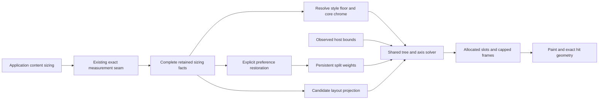

# Complete pane sizing and explicit preference restoration

Status: implemented. Decision date: 2026-11-16.

## Context

Pane measurements previously described minimum content sizes. Production layout
then derived unbounded maxima from the host extent, even though the shared axis
solver already understood finite upper bounds. This could not express a capped
Inspector or a fixed-height tool view. A preferred size also needs a precise
meaning: applying it on every frame would undo user-resized persistent weights.

Sizing belongs to application content. Structure and stored split weights belong
to the workspace; actual native-window bounds remain observed host facts. The
same measured declaration must follow an item into a drag preview, another tabs
leaf, a contained root, or a native surface.

## Decision

Replace the minimum-only measurement with `PaneSizing`, containing validated
width and height `AxisSizing` values. Each axis has a nonnegative finite minimum,
an optional finite maximum, and an optional finite preferred extent. `None`
means no upper bound or no preference. Fixed sizing is the ordinary interval
whose minimum equals its maximum, rather than a separate solver mode.

`PaneSizing::builder()` provides width/height setters and fixed-size shorthands.
`build()` rejects non-finite or negative values, inverted ranges and preferences
outside the declared range. A fixed setter sets both endpoints; subsequent
setters retain ordinary builder ordering. `From<LogicalSize>` is a convenience
for minimum-only declarations, not an alternative measurement protocol.

```rust
let inspector = PaneSizing::builder()
    .min_width(160.0)
    .max_width(420.0)
    .preferred_width(280.0)
    .fixed_height(72.0)
    .build()?;
```

These values describe the content viewport in logical points. Core adds tab
chrome exactly once. The configured minimum pane size remains a baseline floor;
an explicit upper bound caps that floor. Thus an application may intentionally
declare a fixed extent smaller than the style baseline without creating an
inverted interval. Any preferred extent displaced by the baseline is clamped
to the effective interval before chrome is added. Overflow in this composition
is a configuration error.



### Selection and lifetime

Every visible item, including inactive tabs, supplies complete sizing metadata.
The selected visible item supplies its leaf's current declaration. Inactive
declarations support future layouts; they are not intersected with the selected
item. Hidden items are omitted until shown again. Selection reuse compares the
complete effective declaration, and retained source/target facts preserve it
when projecting a candidate move.

Measurements remain transient. Snapshots retain layout and user weights, not
application sizing callbacks or stale measurements. Restoring a workspace asks
the current application for sizing again. There is no second sizing registry.

### Slots, frames and unused space

A slot is the rectangle offered by the parent or host. A frame is the capped
rectangle used for pane content, tab chrome and pane-local interaction. Frames
are anchored at their slot's top-left. A single-leaf root is capped too.

Along a split axis, subtree minima/maxima are summed with separators. On the
cross axis, both envelopes use the largest child value. In particular, maxima
are not intersected across siblings: a short view may leave background below
it while its taller sibling remains usable. Each subtree applies its own cap.

When all maxima saturate, unused space belongs to the containing background.
It does not create a pane receiver, grow an adjacent pane's hit rectangle, or
extend a splitter. Root-level docking guides may still use the offered root
region. Pane-local targets require an actual pane frame.

Unbounded maxima are materialized only when root bounds are known, using a
finite extent sufficient for those bounds and the composed minima. Do not use
`f64::MAX` as an unbounded sentinel or allow infinity into validated rectangles.

Existing `Clip` and `Compress` policies govern infeasible minima. A fixed size
is feasible only when the offered space permits it: compression may reduce its
minimum, and clipping may hide part of its frame. Maximums are never enlarged
to fill unused background. Motion samples are also capped against the current
target's maximum, so changing a cap cannot temporarily paint an oversized view.

### Interaction and preferred sizes

Normal projection uses persistent weights and hard bounds. Preferred extents
are consumed by an explicit `SurfaceSplitterAdjustment::Preferred` action over
an exact presented splitter, using the existing frozen frontier, limit solver,
prepared-action authority and atomic weight commit.

For adjacent children, one preference requests that child's absolute extent.
Two preferences divide the pair's current combined extent in their ratio. A
subtree combines declared preferences with current extents for children lacking
one; an entirely unhinted subtree stays unhinted. No hints fall back to equal
extents. Hard bounds and the complete touching frontier constrain the result.
Junction axes require all incident pairs to agree on one displacement.

The egui adapter exposes configurable double-click behavior: disabled, equalize,
or restore preferred sizes. The default restores preferences with equalization
as its fallback. Keyboard/accessibility adjustments continue through the same
sequence reducer. A preference restoration is a one-time weight update; later
resizes and persistence do not reapply the hint.

There is no implicit first-layout preference mode. Current declarations contain
explicit split weights/fractions, while floating/native placements carry known
bounds. Treating these as uninitialized would invent authority that the input
does not provide. Native-window outer bounds remain host facts: a capped pane
does not authorize resizing its host window. A larger contained/native frame may
therefore contain background around its capped content.

The frozen resize solver describes a linear touching frontier. An affected axis
whose capped frame no longer reaches its moving slot edge has a contact change
that this witness cannot represent. Such a resize is unavailable, without
acquiring capture or publishing partial geometry. Complete frontiers and other
axes remain eligible. Supporting motion through that contact change requires a
separate piecewise-frontier design; silently relaxing geometry validation is
not sufficient.

Published handle availability uses bottom-up edge contacts from that exact root
projection. A perpendicular split may retain unused space, but overflow or
compressed separators still invalidate the frozen witness. Handle publication
and action preparation apply those same geometric requirements; a visible line
must not advertise an input receiver for a resize the candidate cannot prepare.

For example, a 300-point-wide column may contain a top pane capped at 120 points
and an uncapped bottom pane. The outside divider is unavailable because the top
pane does not reach the moving column edge. Hiding that pane restores a complete
frontier without changing stored weights. Resizing through the 180-point slack
would need a breakpoint where the capped pane begins to shrink. Even a partial
implementation that stops at that breakpoint must preserve batch/separate-action
equivalence, preferred restoration, junction limits and pointer reversals. Keep
the existing restriction until that complete interaction has a shared design.

## Alternatives considered

| Alternative | Benefit | Cost and decision |
| --- | --- | --- |
| Complete measurements plus explicit restoration | Keeps one sizing seam and solver; user weights remain authoritative; no new persistent preference state | Chosen. Preferences act on request rather than implicitly initializing every layout. |
| Automatic preferred allocation plus persistent automatic/manual split state | Applies preferred pixels automatically until a user resize | Adds graph, split/merge, snapshot and reset lifecycle rules. Deferred until there is a concrete need for automatic sizing. |
| Constrain only content inside an otherwise unbounded docking pane | Adapter-only implementation and no split changes | Does not provide capped/fixed docking frames or shared previews. Applications may still do this independently for document layout. |
| Keep minimum measurements and add a second optional sizing protocol | Smaller immediate migration | Duplicates source authority and fallback rules. Rejected before release; replace the old variant and callback instead. |

## Implementation and acceptance

1. Add validated sizing values and replace the minimum-only measurement variant,
   retained facts and egui callback. Keep a minimum convenience constructor.
2. Carry effective bounds through current and candidate projections; distinguish
   slots/frames and preserve finite unbounded resolution.
3. Add explicit preference restoration and configurable egui double-click
   behavior through the existing prepared surface action.
4. Check native/contained measurement consumers, motion, invalidation and resize
   admission. Update integration examples and published guide snippets.
5. Run focused numeric and public-contract regressions, then the applicable
   workspace, feature, consumer, native, wasm and documentation gates serially.

Required numeric cases use zero chrome and separator thickness to isolate sizing:

| Input | Required result |
| --- | --- |
| Single leaf, offered width 600, fixed width 200 | Pane frame width 200, root slot width 600 |
| Horizontal siblings, height A `[200,240]`, B `[80,120]`, offered height 220 | A frame height 220, B frame height 120; no declaration conflict |
| Width 600, A `[100,200]`, B `[100,250]` | Widths 200 and 250; 150 background, no pane receiver there |
| Same ranges, width 150 | `Clip`: 100/100 with 50 overflow; `Compress`: 75/75 |
| Pair width 600, only A prefers 200 | Explicit restoration produces 200/400 when feasible |
| Pair width 600, preferences 100/200 | Explicit restoration produces 200/400 when feasible |
| Restore, then resize and save/restore | New weights persist; the hint does not force the old size back |

Additional acceptance checks cover both axes, nested splits, all four fixed/max
combinations, hidden/show and inactive-tab moves, selection-dependent maxima,
preview/commit equality, clamped keyboard/pointer behavior, stale prepared
actions, motion cap changes and native observations differing from content caps.
Existing no-cap fixtures must retain their geometry. Tests compare independently
specified bounds and semantics; agreement between two uses of the same solver
alone is insufficient.

## Risks and mitigations

| Risk | Mitigation |
| --- | --- |
| A maximum is lost in a fast path or future move | Carry one typed declaration in the existing exact roster and facts; compare complete measurements for reuse. |
| Cross-axis caps invalidate a frozen edge assumption | Retain slot/frame geometry and reject only affected unsupported contact changes before capture. |
| Preferences undo manual sizing or become hidden persistent state | Consume them only in an explicit prepared action; persist the resulting ordinary weights. |
| Native actual bounds are replaced by invented cap-compliant bounds | Preserve observed host placement; constrain core presentation within it. |
| Infinite sentinels or chrome addition overflow | Use optional maxima and validated finite composition, with numeric overflow regression. |
| A broad solver change regresses unconstrained performance | Retain the common minimum-only arithmetic path internally and compare existing geometry fixtures and relevant workload costs. |

Related: [renderer-neutral core](0001-renderer-neutral-core.md),
[atomic frames and presentation](0002-atomic-frames-and-presentation.md),
[motion geometry](0005-motion-and-presentation-geometry.md), and
[the ImGui architecture comparison](../research/docking-architecture-review.md).
