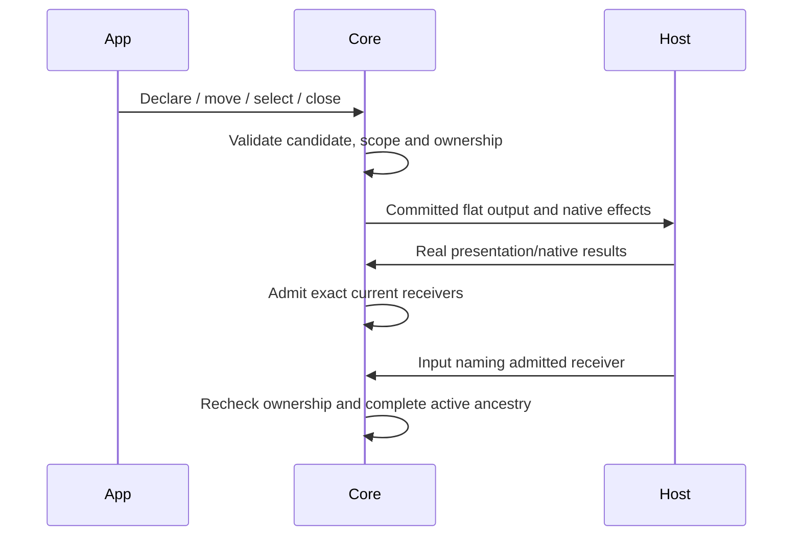

## Goal Capsule

Make Dockspace a renderer-neutral composable docking framework: Pane, Tabs, Split,
and Grid can compose freely, including a complete layout as one tab. Preserve
ordinary tab-group performance, exact input admission, atomic content ownership,
and native-window terminal ordering. Replace unreleased interfaces and schema in
place; document and snapshot format versions remain 1.

## Product Contract

### Requirements

- **R1**: Expose one Pane/Tabs/Split/Grid declaration and read-only traversal model.
  A Pane has no implicit tab bar; a one-child Tabs retains its container semantics.
- **R2**: A Tabs child can be an application Pane or a complete layout. Selection,
  reorder, menus, keyboard navigation, scrolling and dragging address that direct
  child, independently of its descendant application content.
- **R3**: Only the selected eligible Tabs branch is presented. All descendants,
  including inactive and hidden content, remain structurally owned. Activating an
  item reveals its complete ancestor path; showing it alone does not steal focus.
- **R4**: Center insertion can preserve an entire subtree as one tab. Explicit
  tab-group merging moves direct children in order. Close approval for a layout
  tab covers every real descendant and deletes the subtree atomically.
- **R5**: Grid uses shared row/column tracks, fixed or automatically resolved
  dimensions, and persisted user shares. A boundary affects every incident cell.
- **R6**: Resize supports adjacent and nearest-first outward propagation through
  constrained siblings. Pointer, keyboard, accessibility, preferred restoration
  and junction operations use the same evaluator and policy authorization.
- **R7**: Preserve the unique empty central Tabs anchor, separate allocation
  preference, native first-live barriers, affine outcomes and terminal ordering.
  A composite tab is neither a root nor a native-window lifetime.
- **R8**: Preserve stable ItemId content identity, configurable motion, flat host
  rendering and exact presented input. Container chrome and actual application
  Pane placements have separate identities and clipping.
- **R9**: Adapt the public recording host, egui, native egui and GPUI harness;
  demonstrate composition in a small runnable example. Hosts do not solve trees.
- **R10**: Replace the strict v1 persistence schema and examples together. Retain
  no legacy reader, migration, phantom ItemId, parallel reducer or compatibility
  implementation. Remove code made obsolete by the new model.
- **R11**: Verify independent semantic outcomes, exact analytic geometry, stale
  capabilities and resource lifetimes. Measure ordinary layouts and docking
  before/after using existing probes; explain material cost changes.

- **R12**: The egui adapter supplies coherent default interaction and UI for most
  applications. Reassess every affected entry point after the core refactor:
  individual versus group drag, composite-tab scope, docking guides and preview,
  float/dock-back menus, overflow, resize affordances, keyboard/accessibility,
  focus/cancellation and reduced motion. Defaults are usable without application
  reimplementation; documented style and behavior hooks support customization.

### Settled Product Decisions

- **Composition** (session-settled: user-approved — chosen over retaining the
  leaf-only Tabs restriction): free composition is part of the general framework.
  Governs R1, R2, R3, R4, R5.
- **Pre-release replacement** (session-settled: user-directed — chosen over
  migrations and compatibility): breaking changes and redundant-code deletion
  are authorized; version 1 remains current. Governs R10.
- **Responsibility** (session-settled: user-approved — chosen over adapter-owned
  tree semantics): core owns docking decisions and geometry, hosts own native
  observations and rendering. Governs R6, R7, R8, R9.

### Scope

This refactor changes composition and the contracts it directly reaches. It does
not add cell spanning, arbitrary packing, exit snapshots, OS window-manager
replacement, another protocol/authority registry, or changes to open-gpui outside
this repository. Existing unrelated work and excluded user-owned files remain
untouched.

## Planning Contract

### Key Technical Decisions

- **KTD1 — One semantic model, compact direct tabs.** A tagged TabKey identifies
  either an inline real ItemId or a real child NodeId. Tabs owns one ordered
  roster, selection and MRU; a layout entry carries its own presentation metadata.
  Non-Tabs parents can own standalone Pane nodes. No representative descendant
  identifies a layout tab. Runtime node identities are private and session-local.
  This implements R1–R4 without adding arena slots for ordinary inactive tabs.
- **KTD2 — Structural and active traversal are separate.** A common child visitor
  feeds ownership, validation, deletion and persistence. The root compiler also
  records active ancestry, container chrome and concrete content placements.
  Measurements belong to real content; composed constraints are core-owned.
- **KTD3 — Preserve transactional and native seams.** Generic replace/detach and
  all-descendant scope capture extend existing graph candidates, close workflow
  and native lifecycle. A layout-tab close is a new target in that workflow,
  not a second approval system. Selected ancestors are checked when admitting
  old receivers. Reorder/selection alone does not revoke content-close approval.
- **KTD4 — Shared track solver.** Split axes and Grid axes share bounded track
  allocation and typed boundary identities. Grid is not lowered into independent
  row splits. Auto shape resolution is deterministic and frozen in gesture
  proofs; a changed resolved cell map invalidates old handles.
- **KTD5 — Piecewise resizing.** Preserve the linear frontier fast path and extend
  it with exact cap/slack breakpoints. Adjacent or outward capacity transfer is
  evaluated from frozen geometry; reversal is deterministic. All affected owners
  must authorize changes. One rejected junction axis rejects the atomic batch.
- **KTD6 — Presentation continuity.** Real ItemId tracks preserve content state;
  container channels preserve chrome. All rendering, hit order and clips derive
  from one compiled composition. A moving non-partition cannot expose structural
  controls. Unsupported intermediate complex transitions settle coherently until
  their common presentation implementation supports them; do not claim animation
  parity from a simple-pane-only test.
- **KTD7 — Strict v1 replacement.** Serialize actual Pane payloads, typed tab
  children, Split/Grid structure and durable policies. Snapshot-local references
  are remapped; external item keys apply only to real content. Reject malformed
  ownership, cycles and invalid selection without defaulting to the old schema.

### High-Level Technical Design

These sketches describe responsibilities; concrete private types may be refined
without changing the product contract.

```mermaid
flowchart LR
  Declaration --> Graph[Canonical ownership graph]
  Graph --> Measurements[Exact real-content measurement inventory]
  Measurements --> Target[Active composition and target rectangles]
  Target --> Motion[Sampled presentation and clips]
  Motion --> Program[Flat paint, hit and accessibility program]
  Program --> Host[Renderer / native host]
  Host --> Receipts[Presented or Dropped receipts]
  Receipts --> Admission[Exact receiver admission]
```



```text
Pane: application content, no implicit header
Tabs: ordered (Pane | named layout) children; one active child
Split: ordered layouts and one weighted axis
Grid: ordered layouts and shared weighted row/column axes

Ownership walks every child; presentation follows selected Tabs branches.
```



```text
Resize intent -> frozen track owner / shape / policy
  -> unchanged frontier: linear evaluation
  -> contact change: piecewise evaluation
  -> authorize all affected owners
  -> one atomic weight update
  -> target projection -> presentation -> fresh authority

Adjacent stops at the immediate pair's capacity.
Outward consumes nearest eligible siblings before farther ones.
```

```text
Close scope: captured -> pending/deferred -> approved -> revalidated -> committed
                                      \-> vetoed/revoked (cannot revive)
Native scope: provisional -> reservation -> first-live -> promoted -> retiring
Failure never converts an affine result into a successful terminal observation.
```

### Risks and Controls

The largest risks are stale inner receivers, double-counted nested chrome,
accidental subtree flattening, selection-only cache reuse, and cap-contact resize
errors. Units below cover these at their owning seam. Ordinary tab storage remains
compact; a time improvement alone cannot conceal extra validation passes or
untouched-root copying. The existing currentness and lifecycle protocols remain
mandatory even when a convenience interface changes.

## Implementation Units

### U1 — Establish baseline and typed direct-child contracts

Covers R1, R2, R8, R11; implements KTD1 and KTD2.

- Files: `graph.rs`, `graph/shared_storage.rs`, `graph/command.rs`, `ids.rs`,
  `model/layout.rs`, `model/view.rs`, scene tab identities and runtime tab records.
- Capture existing layout/docking/host cost outputs and preserve executable hashes.
- Introduce opaque typed TabKey, one roster interface and distinct ItemSource and
  TabSource. Keep ItemId exclusively for application content and content state.
- Test scenarios: ordinary tabs preserve order/MRU and pre-removal gap semantics;
  layout keys cannot collide with item keys; standalone Pane has no tab chrome;
  normal direct tabs do not allocate an extra Pane graph node.

### U2 — Make graph operations composable

Covers R1–R4, R7; implements KTD1–KTD3.

- Files: graph authority, workspace, root_structure, canonical, validation,
  visibility, operation/topology, close plans and product actions.
- Generalize child traversal, placement and replacement for Tabs/Split/Grid.
  Preserve identity at direct layout-tab boundaries. Expose explicit subtree tab
  insertion versus group merge. Extend central retention and atomic close scopes.
- Test scenarios: reorder a layout tab without changing its key; move a subtree
  across roots without flattening; close a nested tab with veto/deferred approval;
  remove selected child with two surviving siblings; retain only the main central
  anchor when all real items leave; owner/membership changes revoke old approvals.

### U3 — Compile and interact with nested tabs end to end

Covers R2, R3, R8, R9, R12; implements KTD2, KTD3 and KTD6.

- Files: presentation requirements/layout/compiler/scene/hit, runtime measurement
  and paint, engine selection/input/focus/drag/motion, egui render and PaneView.
- Separate Tabs chrome from content placement, compose active child constraints,
  carry exact ancestor activation and restrict simple selection-only rebind.
  Resolve focus independently of a composite tab's label. Extend flat host output.
- Test fixture: outer Tabs contains C and Split(inner Tabs[A,B], bare D). Select C
  and observe only C; select the layout tab and observe A plus D and both bars;
  select B without changing the outer key/title. Switch away and reject all old
  inner Pane/splitter receivers. No inactive callbacks, paint or hit regions.
- Verify header navigation versus content activation, clipping, menu close/move,
  touch, overflow, explicit whole-group and individual-tab drag paths.
- Audit the adapter's entry-point matrix against the new scopes. Provide complete
  default chrome and feedback, accessible names and hit targets, predictable
  cancellation/focus restoration, and concise customization guidance. Layout-tab
  actions must communicate their whole-subtree scope without requiring text
  overlays for every docking target.
- Center-drop defaults follow the captured source: a pane tab inserts that Pane,
  an existing layout tab preserves its subtree, and a whole-Tabs merge gesture
  merges direct children. A distinct preserve-subtree group gesture uses a
  configurable modifier (default Alt), advertised on the group grip, with an
  equivalent accessible/menu command. Its preview presents one layout tab;
  the merge preview presents the incoming direct tabs. Test both gestures and
  require the submitted structure to match their previews.

### U4 — Add shared Grid tracks and deterministic Auto topology

Covers R1, R5, R8, R9; implements KTD2, KTD4 and KTD6.

- Files: model/grid, graph traversal/operations, layout track allocation, scene
  boundaries, future preview, splitter input and adapters.
- Fixed Grid first; share every column and row allocation. Auto chooses a stable
  count/aspect shape with deterministic ties; preserve user shares for unchanged
  shape and reset new track dimensions deterministically. Freeze shape in handles.
- Test scenarios: 404x204 two-by-two, gap 4, cells 200x100; a +20 column adjustment
  changes both rows to 220/180; a +10 row adjustment changes both columns to
  110/90. Test caps with uncapped peers, insufficient extent, hidden cells, Auto
  shape changes, stale handles, nested tabs and translation/transpose invariance.

### U5 — Unify constrained resize and propagation

Covers R6, R8; implements KTD4 and KTD5.

- Files: splitter_geometry, pointer_splitter, splitter_restoration, resize_contact,
  public resize configuration and existing splitter regressions.
- One piecewise plan evaluates every input path; preserve cheap linear cases.
  Authorize every affected owner and keep junction batches atomic.
- Test scenarios: capped/slack contact crossings; three-sibling nearest-first
  outward capacity; saturation and reversal to zero; denied farther owner; hidden
  and inactive branch; preferred/equalize after reversal; batched/separate action
  equivalence; policy or Auto shape change during gesture revokes old preparation.

### U6 — Replace persistence and migrate all consumers

Covers R7–R10; implements KTD1, KTD3, KTD6 and KTD7.

- Files: persistence snapshot/document/restore, recording host/conformance,
  egui/native egui, GPUI harness, examples and adapter guide.
- Replace v1 in place, remap typed keys correctly, remove superseded APIs and
  compatibility code. Publish one concise composable example and host guidance.
- Test scenarios: roundtrip complete hidden/inactive tree and weights; corrupt
  child keys/cycles/shared ownership/duplicate content reject; migrate nested
  group to a native child and back; close one group with native siblings retained;
  delay/drop old output and prove callbacks cannot acquire a newer lifetime.

### U7 — Independent validation, performance and final simplification

Covers R1–R11; implements KTD1–KTD7.

- Extend existing test owners with a small labelled tree reference model; do not
  copy the production solver or create another authority registry/test platform.
- Run analytic geometry, scope and native acceptance alongside existing regressions.
  Review changes independently, remove obsolete helpers and update core ADRs.
- Compare existing 16/128/1024-pane, 1/4-view benchmarks and host allocation probes.
  Add focused inactive-subtree and Grid workloads to the current probe owners.
  Preserve common logical workload/export while reporting actual storage counts.

Dependencies: U1 -> U2 -> U3 -> U4 -> U5; U6 follows the stable U3/U4 contract;
U7 gathers evidence throughout and completes after U5/U6. Shared core declarations
have one editor; adapter and independent-test work can run after those contracts
freeze. Commits group compiling, validated behavior rather than half-migrated types.

## Verification Contract

Cargo commands run sequentially with `CARGO_BUILD_JOBS=2`; nextest uses two test
threads and existing target directories. Start with focused tests, then core all
features, workspace all targets/features, minimal/serde, independent host/product,
native and wasm checks required by the changed seams. Use `cargo fmt`, appropriate
Clippy checks, documentation build, and real platform qualification when native
input/output code changes. A headless callback is not evidence of OS presentation.

Correctness gates: independent expected active ItemIds and complete child order;
analytic Grid geometry; no duplicate/lost ownership; exact close scopes; no stale
ancestor receiver; preserved first-live/terminal protocol; valid strict v1 restore.
Tests distinguish legal external waiting from irrecoverable failure and genuine
lack of progress.

Performance gates: save before/after raw outputs and source/executable metadata.
Use independent process blocks in opposing orders and establish old/old noise
before judging a slowdown. Primary metrics are owned-operation total and full
projection, with p95, phase costs and heap evidence separate. A demonstrated
ordinary-tab slowdown beyond the repeatability envelope requires attribution and
optimization or an explicit documented trade-off; inconclusive timing is reported
as such. Untouched container payloads/roots remain shared, ordinary tabs gain no
per-item arena node, and no redundant validation/candidate pass is introduced.

## Definition of Done

All requirements, including complete egui default interactions, have working public behavior and focused independent tests;
workspace and affected external consumers build; supported native lifetimes retain
their existing protocol; strict persistence stays v1; existing simple workflows
retain measured acceptable costs; obsolete implementations are removed; examples,
API documentation and ADRs describe the resulting contract; independent review has
no unresolved correctness finding. A plan file or partial identity migration alone
does not satisfy this definition.
